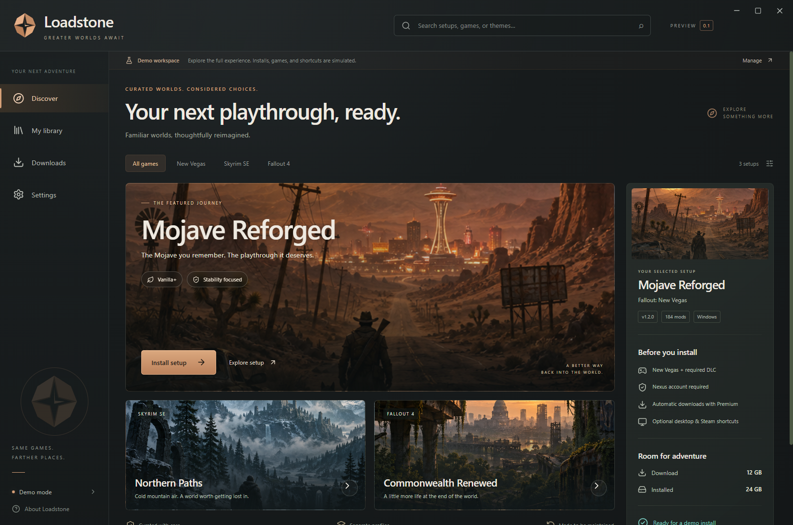

# Loadstone

**Your next playthrough, ready.**

A Windows developer preview of a curated Bethesda modlist installer, built with Svelte 5, TypeScript, and Electron. Charcoal panels, copper accents, and original cinematic artwork carry the approved Loadstone visual direction into an interactive app.



## Windows preview

Build the current **0.3.0 native creator preview** with `pnpm package`, then run `release/Loadstone-0.3.0-Windows.exe`. The portable executable needs no Node.js, pnpm or installation wizard to run. It is unsigned and has not been published as a new hosted release. The existing private v0.1.0 release is the older demo-only build.

## Run locally

Requires Node.js 22+ and pnpm 11+.

```powershell
pnpm install
pnpm start
```

```powershell
pnpm check     # Svelte and TypeScript diagnostics
pnpm test      # State-engine tests and real Electron end-to-end tests
pnpm package   # Portable Windows x64 executable in release/
```

To test the actual packaged application and portable wrapper:

```powershell
$env:LOADSTONE_TEST_EXE = "$PWD\release\win-unpacked\Loadstone.exe"
node --test tests/electron.test.mjs
Remove-Item Env:\LOADSTONE_TEST_EXE
node scripts/verify-portable.mjs
```

See [the review checklist and verification notes](docs/review.md).

## Review the MVP

1. Browse Discover; filter by game or search for a setup.
2. Open setup details, then Install setup. Choose an installation plan and start the demo.
3. Pause, resume, cancel, or retry in Downloads. A complete demo takes approximately 20 seconds.
4. Open My library to launch a demo session, verify the simulated profile, or remove it.
5. On first run, choose **Set up real installations** for engine/account setup, then import a live manifest in Discover. Choose **Explore the demo** for the fictional catalog. Switch modes later with **Use dummy data** in Settings. Your choice, reduced motion, shortcut preferences, and folder selection persist.
6. Export a privacy-conscious diagnostic summary or reset the demo workspace from Settings. Raw installation output remains local in Downloads.

The demo catalog, requirements, installation sizes, profile validation, launch, and shortcut creation are simulated. Demo mode does not download mods, launch game processes, change game files, or modify Steam. Turning demo mode off prevents demo mutations in the main process as well as hiding sample data in the renderer.

Current source also supports a separate live manifest catalog, Steam game discovery, manual game selection, SHA-256 compatibility checks, destination/storage preflight, and a Wabbajack installation runner with saved jobs, cancellation and retry. See [manifest requirements](docs/manifests.md) and [installation behavior and limits](docs/installation.md). Controlled process tests pass; a full real modlist installation has not yet been verified. Live library launch, profile checks, and desktop/Steam shortcut creation and repair are implemented. Steam integration still needs actual-client acceptance testing. The existing v0.1.0 release predates these features.

Settings now prepares a pinned official Wabbajack runtime, with download/cancel/repair controls, archive and full runtime integrity checks, and a real CLI capability check. See [runtime integration notes](docs/runtime.md). Preparing the engine does not install a modlist.

Settings also validates a Nexus personal API key for private testing, stores it with Windows encryption, and displays account membership and the last verification time. [Account integration notes](docs/nexus.md) describe credential handling and installation requirements. This is not yet a registered public Nexus application.

Creator tooling can [inventory an installed MO2 setup and compare original archives](docs/installed-inventory.md) without changing it and [compile or inspect the documented native `.loadstone` package format](docs/loadstone-format.md). **Settings → Native package preview** checks a selected package and shows its required games, sources, profile and save guidance. **Reconstruct a local candidate** reviews private local inputs, optionally [acquires declared original archives](docs/native-downloads.md), and builds copy and ZIP/7z/RAR-extract recipes into a new folder with final-file hashing, cancellation and durable history. Recipes can [generate MO2 configuration for that destination](docs/native-mo2-configuration.md) without importing account data. [Native reconstruction](docs/native-reconstruction.md) remains experimental: real provider/account acceptance, complete profile/tool configuration, repair and launch acceptance are unfinished. Verified candidates can be explicitly reviewed and registered through [My library → Add native candidate](docs/native-library.md), with recipe verification, isolated-profile launch and Desktop/Steam shortcut controls. [Native removal](docs/native-maintenance.md) preserves saves, configuration, modified files and untracked content in a recovery folder and supports retry. Native repair/update and actual install-to-play acceptance remain unfinished. The featured lists are not publication-ready.

## Persistence and desktop behavior

Settings and demo state live in `%APPDATA%\Loadstone\state.json` in the packaged app. Active demo installs are restored paused after a restart. Disabling demo mode preserves its state and pauses its jobs. Resetting demo data preserves preferences. Unreadable demo state is backed up before recovery. Live jobs are saved separately in `live-jobs.json`; interrupted live installations require a Windows restart before retry. Native Windows folder/save dialogs, window controls, a single-instance guard, and offline artwork are included.

For isolated automated testing, set `LOADSTONE_DATA_DIR` to a dedicated directory. Never point it at a directory whose files you need to preserve.

## Architecture

- `src/`: Svelte interface, catalog, styling, and typed desktop bridge.
- `electron/main.cjs`: native window, validated IPC, dialogs, and state notifications.
- `electron/preload.cjs`: limited context-isolated bridge; no arbitrary filesystem/process access.
- `electron/store.cjs`: persistent simulated installation state machine.
- `electron/manifest.cjs`, `game-discovery.cjs`, `live-catalog.cjs`: live setup validation, local game discovery, and filesystem preflight.
- `electron/installer.cjs`: durable live jobs, engine process control, credential handoff, and structural profile verification.
- `tests/electron.test.mjs`: real Electron workflows and backend invariants.
- `public/worlds.png`: original AI-generated triptych for the three fictional setups.
- `scripts/create-icon.py`: geometric app icon generator (Pillow needed only to regenerate artwork).

Real install-to-play, Steam-client and save-preservation acceptance remain necessary before a public installer release. [The 1.0 acceptance plan](docs/1.0-plan.md) tracks the complete release requirements, including open-source documentation, license review and notices.

## Distribution

Loadstone's original source code is licensed under **GPL-3.0-or-later**: GNU GPL version 3 or, at your option, any later version. See the full [license](LICENSE) and [copyright/scope notice](COPYRIGHT). The repository remains private pending publication review. No Wabbajack or MO2 application source is incorporated in this preview; third-party packages retain their respective licenses. The portable Windows preview is unsigned and is not a Steam release.

See [contributor setup](CONTRIBUTING.md), [security reporting](SECURITY.md), [privacy and local data](docs/privacy.md), and [open-source publication gates](docs/open-source.md). New packages carry Loadstone's license and scope notice under `resources/licenses/`, alongside generated [third-party notices](notices/THIRD-PARTY.txt) and the [dependency inventory](notices/dependencies.json). The About screen displays the license offline. The shipped dependency inventory currently has no missing license texts. It covers bundled renderer code, main-process dependencies and Electron; excluded build tools, artwork/branding and distribution rights still require review. Licensing Loadstone does not license third-party mods or game files.

For a separate unpacked Windows Steam depot preview, run `pnpm package:steam`. See [Steam packaging and acceptance](docs/steam-release.md) for file verification, packaged-executable tests, templates and remaining submission gates. This command does not upload or publish.

See [0.3.0 release notes](CHANGELOG.md) for implemented creator/live features and outstanding release gates.
