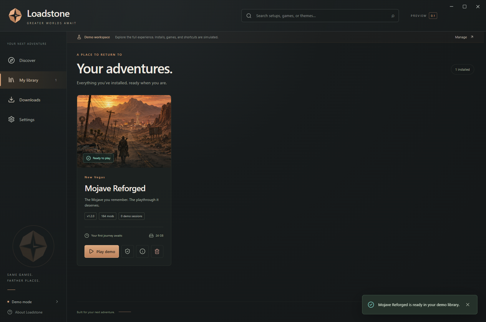
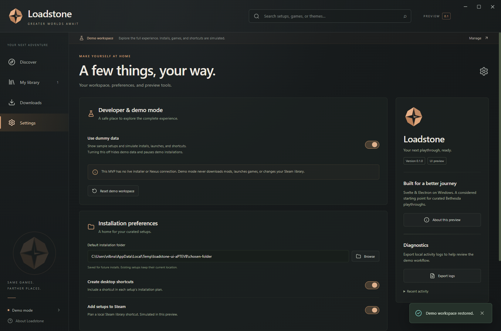

# Loadstone 0.1.0 review

The Windows UI MVP is ready to review. It implements the approved visual direction in Svelte and Electron, with persistent dummy data that can be disabled in Settings.

## Suggested walkthrough

- Discover: filter by game, search, select another setup, and open its details.
- Install setup: change the destination and shortcut preferences; begin a demo installation.
- Downloads: pause, resume, cancel, retry, and clear completed/cancelled jobs.
- Restart during an install: the job returns paused and can resume.
- My library: launch a demo session, verify its plan, view details, or remove the setup.
- Settings: toggle dummy data off and back on. Demo state is preserved, but hidden and blocked while off.
- Change shortcut defaults and reduced motion, then restart to check persistence.
- Browse for a folder, export logs, and reset the demo workspace.
- Resize or maximize the app and navigate using the keyboard.

## Verification performed

- Svelte/TypeScript check: zero errors and zero warnings.
- Persistent state engine: live-mode mutation guards, duplicate prevention, pause recovery, completion, uninstall, invalid inputs, and settings retention.
- End-to-end tests run against the **packaged Loadstone.exe**, not only the browser/source build: discovery, filters, search, details, install, pause, resume after restart, completion, library, launch, verification, settings persistence, dummy-data isolation, uninstall, cancel/retry, and reset.
- Window minimize/maximize controls, minimum-size horizontal layout, and dialog keyboard focus containment.
- Folder and log-export IPC handlers exercised with controlled native-dialog return values; the log file was actually written and inspected.
- Portable **Loadstone-0.1.0-Windows.exe**: extraction, launch, renderer and bridge, persistent setting mutation, live-mode empty state, and clean wrapper/app shutdown.
- No renderer page errors during the end-to-end review journey.

Generated verification records are included beside this document. Screenshots come from the running Electron application.

## Intended limits

This is a UI MVP. All modlists, game requirements, installation sizes, checks, downloads, profile creation, game launches, and per-setup shortcuts are simulated. Folder selection, preferences, local logs, window controls, and app persistence are real. No live Nexus, Wabbajack, MO2, or Steam integrations are incorporated yet. The Windows portable executable is unsigned.

